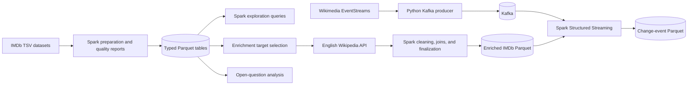

# IMDb Big Data Project

**A reproducible Apache Spark and Kafka project for IMDb data quality,
large-scale film analysis, Wikipedia enrichment, and live change streaming.**

[](https://www.python.org/)
[](https://spark.apache.org/)
[](https://kafka.apache.org/)
[](https://docs.docker.com/compose/)

## Project overview

This project processes IMDb's seven non-commercial TSV datasets with Apache
Spark. It profiles and prepares the raw data, answers the assignment's
multi-table analysis questions, enriches selected films and principals from
English Wikipedia, and consumes Wikimedia change events through Kafka and
Spark Structured Streaming. A final open-question analysis explores the
relationship between alternate-title region coverage and IMDb film performance.

The pipelines are designed to be reproducible from a clean checkout. Large
source datasets and generated reports are intentionally kept outside Git.

## Pipeline at a glance



## Results snapshot

Results below were generated from the local IMDb snapshot used for the report.
See [REPORT.md](./REPORT.md) for the full methodology, tables, limitations,
and references.

| Workstream | Selected results |
| --- | --- |
| **Data preparation** | Seven typed Parquet tables; 39 per-column quality records; 11 data-quality findings. The five most incomplete fields have 80.66–99.47% absent values. |
| **Data exploration** | Ten result sets. The top-three genre ranking covers all years from 1980 to 2025; the two language-based actor queries returned no qualifying rows. |
| **Wikipedia enrichment** | 7,151 selected films and 21,401 film–principal associations. Wikipedia text was found for 5,104 film summaries and 17,404 principal associations. |
| **Live streaming** | 17 min 46 sec; 1,591 candidate changes across 144 micro-batches; 0 exact IMDb page-ID matches and no logged EventStreams disconnections. |
| **Open question** | Across 223,494 rated feature films, 5+ alternate-title regions were associated with more votes than one region in all 106 comparable genre–decade strata. Median rating did not increase. |

### Alternate-title region coverage and median votes

The bar lengths are scaled to the largest median; exact values are shown at
right. Region coverage is an IMDb alternate-title proxy, not verified evidence
of theatrical distribution.

```text
5+ regions          ████████████████████  332
2–4 regions         ███                    56
1 region            █                      24
No recorded region  █                      17
                    Median IMDb votes
```

## Quick start

The recommended runtime is Docker Compose. Install Git and Docker (Docker
Desktop with Linux containers on Windows), then run these commands from
PowerShell or a compatible shell:

```powershell
git clone https://github.com/bonivalyvan/Big-Data-Test.git
cd Big-Data-Test
docker compose build spark
docker compose run --rm spark -m unittest discover -s tests
```

Download and prepare the seven IMDb datasets:

```powershell
docker compose run --rm spark -m src.download_imdb --confirm-large-download
docker compose run --rm spark -m src.prepare_data
docker compose run --rm spark -m src.explore_data
```

The full compressed IMDb download was about 2 GB for the snapshot used here;
allow additional disk space for Parquet files and Spark temporary data.
Enrichment collection is rate-limited and takes at least about five hours:

```powershell
docker compose run --rm spark -m src.enrich_data targets
docker compose run --rm spark -m src.collect_wikipedia --max-entities 5
docker compose run --rm spark -m src.collect_wikipedia
docker compose run --rm spark -m src.enrich_data finalize
```

Run the additional analysis after preparation:

```powershell
docker compose run --rm spark -m src.open_question
```

Streaming requires the finalized enrichment outputs. See
[PROJECT.md](./PROJECT.md) for the live run, shutdown, restart/checkpoint
behavior, output paths, and overwrite options.

## Repository guide

| File | Description |
| --- | --- |
| [PROJECT.md](./PROJECT.md) | Environment setup and step-by-step execution and operations guide |
| [REPORT.md](./REPORT.md) | Final results, methodology, limitations, and references |
| [project_instructions.md](./project_instructions.md) | Assignment requirements |
| `src/` | Spark preparation, exploration, enrichment, streaming, and open-question pipelines |
| `tests/` | Focused unit and transformation tests |
| `compose.yaml` | Spark and optional Kafka streaming services |

Generated data, checkpoints, and CSV/Parquet outputs are stored under the
ignored `data/` directory and can be recreated by following
[PROJECT.md](./PROJECT.md). IMDb and Wikimedia data are subject to their own
terms and licenses. AI-tool contributions are disclosed in
[PROJECT.md](./PROJECT.md) and [REPORT.md](./REPORT.md).
